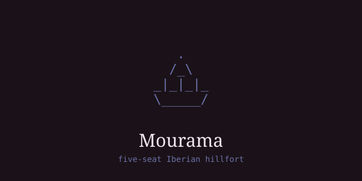
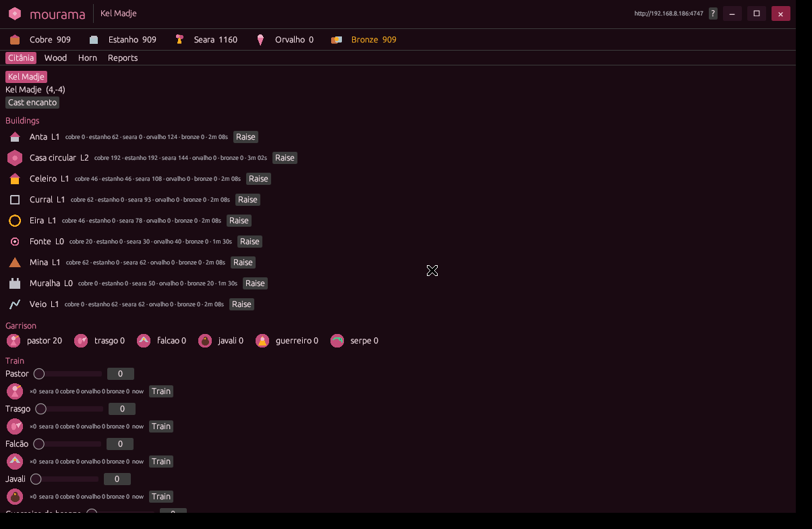

# Mourama 🏔️

> Status: pre-alpha, world offline. Free, open-source online game — not playable yet.
> We have no server/host box/domain. Looking for someone to invest in a small host + domain for a closed 5-seat alpha: `evenweaker@disroot.org` subject `host: mourama`.

Iberian persistent hillfort. Five seats. The office box was the world; without a host box the world sleeps.

You keep a **citânia**. Resources are **cobre**, **estanho**, **seara**, and
**orvalho**. Cobre + estanho make bronze. Orvalho pays for **encanto**
(veil) and a **serpe** bind (conquest). Wild hills are **mamoas**. Travel
is the between.

This is a faeOS engine (`ElegantVW/mourama`), not a faeOS in-tree app.
Free and open source (MIT). One Rust binary, authoritative tick, SQLite on disk.
Native window `mourama-play`, five accounts max — the sixth is refused in code and in lore.

## What you do

Keep your citânia alive: gather cobre + estanho to make bronze, work the seara, spend orvalho on encanto (veil) and serpe binds (conquest). Wild hills are mamoas. Travel is the between. Phones are windows, never the world.

## Hosting needed

No public server right now. Plan stays closed: invite codes, Tailscale/LAN first, never open `:4747` to the whole internet. What we need: a small always-on box + domain to hold the world for 5 seats. If you can host or fund it, mail `evenweaker@disroot.org` subject `host: mourama`.

## Look




```
   .   
  /_\  
_|_|_|_
\_____/
```

## Play (local dev only, world offline)

Builds and runs, but there is no public world to join yet:

```
cd ~/mourama && ./build.sh install
mourama invite          # one-time code, max 5 seats
mourama play            # native window (Linux)
```

Server stays on `:4747`. The window is `mourama-play`, not a browser.

Windows zip (when mingw is installed): `./build.sh windows` → `~/Downloads/mourama-windows.zip`.
APK (when JDK+SDK are installed): `./build.sh apk` → `~/Downloads/mourama.apk`.

## Keep the box awake

```
sudo ./build.sh keep-awake
```

Lock with Seal (`Mod+Ctrl+l`). Suspend (`Mod+Ctrl+Shift+l`) stops the world.

The user unit is enabled. For it to survive logout:

```
sudo loginctl enable-linger evenweaker
```


## Reach

Phones at home join the same Tailscale tailnet as this box. See
[docs/REACH.md](docs/REACH.md). World design: [docs/DESIGN.md](docs/DESIGN.md).

## Roadmap (closed alpha, 5 seats max)

1. Small always-on box + domain (seeking host — `host: mourama`).
2. Invite codes + SQLite world on disk (`0600`, never git).
3. Native `mourama-play` + phones as windows on the same tailnet.
4. No open `:4747` to the whole internet, ever.
